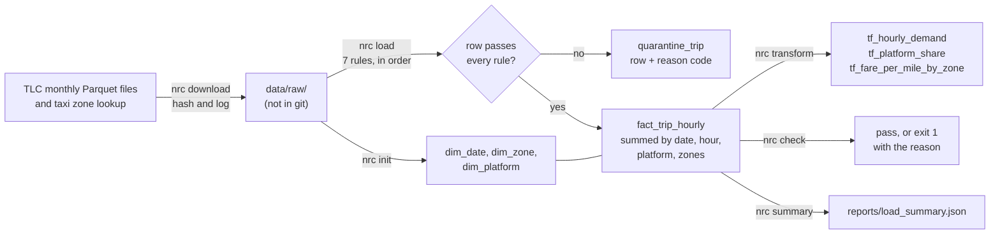
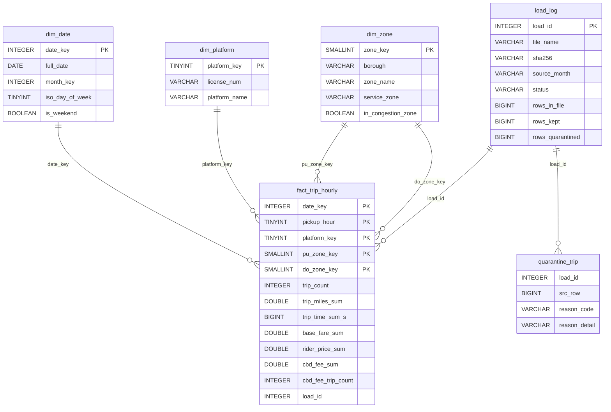

# nyc-rideshare-congestion

A tested pipeline for NYC Lyft and Uber trip data, and a study of what congestion pricing changed.

## In plain words

New York City publishes a record of every Uber and Lyft trip. This project loads
those records into one small database, checks each one, and sets aside the broken
ones with a note that says what is wrong. The second half will use the clean data
to ask whether the new toll on driving into lower Manhattan changed how many people
take Uber and Lyft into that area. That second half is not done yet.

## Try it

You need [uv](https://docs.astral.sh/uv/). The demo downloads nothing and needs no keys.

```bash
make setup     # or: uv sync
make demo      # or: uv run nrc demo
make test      # or: uv run pytest
```

`make demo` writes a fake zone list and two fake months of trips into a temporary
folder. Then it runs the real pipeline commands on them and deletes the folder. The
fake rows are random with a fixed seed. They are not real trips and say nothing about
NYC. A shortened run looks like this:

```text
== Validate, quarantine and load: nrc load --all
loaded 2024-12: kept 1563, quarantined 8 (NULL_REQUIRED 1, PICKUP_OUTSIDE_MONTH 1, UNKNOWN_ZONE 1, NEGATIVE_FARE 1, NEGATIVE_DISTANCE 1, IMPOSSIBLE_DURATION 1, DUPLICATE_TRIP 2), other platform 3, fact rows 1562
loaded 2025-01: kept 1563, quarantined 8 (...), other platform 3, fact rows 1562

== Load again: both months skip, no rows added: nrc load --all
skip 2024-12: already loaded
skip 2025-01: already loaded

== Check the loaded months: nrc check --from 2024-12 --through 2025-01
check passed: 2 months, 2024-12 to 2025-01

== Check one month past the data: this should fail: nrc check --from 2024-12 --through 2025-02
FAIL freshness 2025-02: 0 loaded rows in load_log, expected 1
FAIL freshness 2025-02: newest fact day 20250131 is not in the last month 2025-02
check failed: 2 problems in 2024-12 to 2025-02
```

`make` may not be installed on Windows. Each target is one `uv run` command, listed
in the [Makefile](Makefile).

To run the pipeline on the real data instead, see [Run it on the real data](#run-it-on-the-real-data).

## Result

The project has two parts. Part 1, the pipeline, is built and has loaded all 27
monthly files, from January 2023 to March 2025. Part 2, the congestion pricing study,
is in progress. Its plan was written and committed before any outcome was computed,
and it has no results yet. This README shows no outcome numbers until the analysis
step runs.

### Part 1: where every trip row went

The table comes from `reports/load_summary.json`, written by `uv run nrc summary`. It
adds up all 27 months.

| Step | Rows |
|---|---|
| Rows in the downloaded files | 532,242,474 |
| Rows from other platforms (not Uber or Lyft), counted and left out | 0 |
| Rows kept | 532,128,361 |
| Rows quarantined | 114,113 |
| Rows in the fact table | 242,369,412 |

Kept rows plus quarantined rows equal the rows in the files, and the `nrc check`
command tests that sum for every month. The quarantined rows are 0.0214% of all
rows. Each one has a reason code. A row that breaks more than one rule gets the code
of the first rule it breaks, in this order:

| Order | Reason code | What is wrong with the row | Rows |
|---|---|---|---|
| 1 | `NULL_REQUIRED` | A column the fact table needs is empty | 0 |
| 2 | `PICKUP_OUTSIDE_MONTH` | The pickup time is not in the file's month | 0 |
| 3 | `UNKNOWN_ZONE` | The pickup or drop-off zone is not in the TLC zone list | 0 |
| 4 | `NEGATIVE_FARE` | A fare or fee column is below zero | 90,092 |
| 5 | `NEGATIVE_DISTANCE` | The trip distance is below zero | 0 |
| 6 | `IMPOSSIBLE_DURATION` | The trip time is zero or less, the drop-off is not after the pickup, or a length is over six hours | 19,982 |
| 7 | `DUPLICATE_TRIP` | An exact copy of an earlier row in the same file that passed rules 1 to 6 | 4,039 |

The fact table has fewer than half as many rows as there are kept trips. That is by
design. Its grain (what one row stands for) is one row per pickup date, pickup hour,
platform, pickup zone and drop-off zone. All kept trips that share those five values
are added up into one row, with a trip count, total miles, total time and total
fares. The five columns are the table's primary key in
[sql/schema/05_fact_trip_hourly.sql](sql/schema/05_fact_trip_hourly.sql), so the
database refuses a second row for the same cell.

### Part 2: the congestion pricing study (in progress)

On January 5, 2025, New York started charging a toll to drive into the busiest part
of Manhattan, the Central Business District. The study will ask whether Lyft and Uber trips into that zone changed,
compared with trips elsewhere in the city. It will then say what a rideshare platform
should do about it. The method, the checks and the stop rules are fixed in
[docs/eval_plan.md](docs/eval_plan.md). No trip counts, fares or durations by zone or
month have been reported yet.

## How I worked

- Evaluation plan, written before any results: [docs/eval_plan.md](docs/eval_plan.md),
  added in commit `31ee0673187120ee997b6a4843c0a599855e109a`. Any later change to the
  plan needs its own decision record named `NNNN-deviation-*.md`.
- Decision records: [docs/decisions/](docs/decisions/). They cover the data sources,
  the choice of DuckDB, the data model, the load and quality rules, and the index test.
- Error analysis: not yet. It comes with the Part 2 results.
- How ready it is for production, scored against Breck et al.'s checklist:
  [docs/ml_test_score.md](docs/ml_test_score.md).
- How the AI assistant was used: [AI_USAGE.md](AI_USAGE.md).

## How it works



1. `nrc download` fetches one monthly file at a time from the TLC. It records each
   file's SHA-256 hash and size in `load_log`, and skips a file it already has.
2. `nrc load` reads one month at a time in DuckDB, with a memory cap of 2 GB and spill
   space on disk. Each row passes seven rules in a fixed order. A row that fails one
   goes to `quarantine_trip` with its reason code.
3. Kept rows are summed into `fact_trip_hourly`. A month loads inside one transaction,
   so a crash leaves no half-loaded month. Loading the same file again adds nothing,
   because the load is [idempotent](docs/glossary.md#idempotent).
4. `nrc transform` builds three report tables with SQL CTEs and window functions, from
   the files in [sql/transforms/](sql/transforms/).
5. `nrc check` tests freshness, row counts and key integrity, and exits 1 with a clear
   message if anything is wrong. It runs when you call it, not on a timer.

### The star schema

The warehouse is a star schema: one fact table of counts and sums in the middle,
with small lookup tables (dimensions) around it.



`dim_zone.in_congestion_zone` marks the 38 taxi zones on the MTA's list of zones
inside the congestion zone. The diagram shows the main columns only. The full
definitions are in [sql/schema/](sql/schema/) and
[ADR 0003](docs/decisions/0003-data-model.md).

### Run it on the real data

The 27 monthly files take 13.05 GB. The download step refuses to start unless free
disk space is at least the file size plus 20%. The warehouse needs more space on top
of that.

```bash
uv run nrc download --all     # one file at a time; safe to stop and run again
uv run nrc init
uv run nrc load --all         # one month at a time; skips months already loaded
uv run nrc check
uv run nrc transform
uv run nrc summary            # rewrites reports/load_log.json and reports/load_summary.json
```

## What's weak

Ranked by how much each could change what the data says. The full list is in
[docs/whats_weak.md](docs/whats_weak.md).

1. The rules catch only values that cannot be true, such as negative fares or a
   drop-off before the pickup. Values that are possible but strange, such as a very
   long trip with a normal fare, are kept.
2. The quarantine numbers describe the files as the TLC published them on the download
   dates in `reports/load_log.json`. If the TLC fixes a file later, a reload with
   `--backfill` is needed, and the numbers will change.
3. Everything runs on one laptop in DuckDB, with a memory cap of 2 GB. On the full
   fact table, building the timed index ran out of memory. The index was timed on a
   three-month slice instead, as [ADR 0007](docs/decisions/0007-transforms-check-and-index.md)
   records. Those timings are single-machine numbers.
4. The tables have no foreign key clauses, because DuckDB foreign keys block the
   reload deletes. `nrc check` tests every fact key against its dimension instead, but the database itself does
   not stop an orphan key.
5. Part 2 has no results yet, so nothing here says anything about congestion pricing.

## Data and terms of use

- Trip records: NYC Taxi and Limousine Commission (TLC), High Volume For-Hire Vehicle
  trip records, from the
  [TLC trip record data page](https://www.nyc.gov/site/tlc/about/tlc-trip-record-data.page).
  `HV0003` is Uber and `HV0005` is Lyft, as the
  [TLC data dictionary](https://www.nyc.gov/assets/tlc/downloads/pdf/data_dictionary_trip_records_hvfhs.pdf)
  says.
- Taxi zone lookup: also from the TLC trip record data page.
- Zones inside the congestion zone: the MTA dataset
  [MTA Central Business District Taxi Zones](https://data.ny.gov/d/yfdc-w5jh) on
  data.ny.gov.
- Terms: the TLC page gives no license and says that "TLC makes no representations as
  to the accuracy of these data." The
  [NYC.gov Terms of Use](https://www.nyc.gov/main/terms-of-use) apply. They say the
  content comes "as is" with no warranty. The MTA dataset lists no license.
- This repo does not republish trip rows. Raw files stay in the gitignored `data/raw/`
  folder. Only totals, tables and charts are committed. Tests and the demo use made-up
  rows only. Details are in [DATASHEET.md](DATASHEET.md) and
  [ADR 0001](docs/decisions/0001-data-sources.md).

## Docs

- Tutorial: [docs/tutorial.md](docs/tutorial.md)
- How-to guides: [docs/how-to/](docs/how-to/)
- Reference: [docs/reference.md](docs/reference.md)
- Explanation: [docs/explanation.md](docs/explanation.md)
- Glossary: [docs/glossary.md](docs/glossary.md)
- Datasheet: [DATASHEET.md](DATASHEET.md)
- Changes: [CHANGELOG.md](CHANGELOG.md)

## Repo map

<!-- repo-map:start -->
| Path | What it holds |
|---|---|
| `.github/` | CI workflows and GitHub settings |
| `CLAIMS.md` | Every number in the docs, with its source file and command |
| `data/` | Small data files, or scripts that download the data |
| `docs/` | Evaluation plan, decisions, glossary and the four kinds of docs |
| `Makefile` | One command for each step: setup, lint, test, eval, demo |
| `reports/` | Generated results, including metrics.json |
| `sql/` | Warehouse DDL (`schema/`), the load inserts (`load/`), the SQL transforms (`transforms/`) and the timed index (`index/`) |
| `src/` | The package code |
| `tests/` | Unit and data tests |
| `tools/` | Checks for claims, readability, AI-writing signs and links |
<!-- repo-map:end -->

## License

MIT. See [LICENSE](LICENSE).
